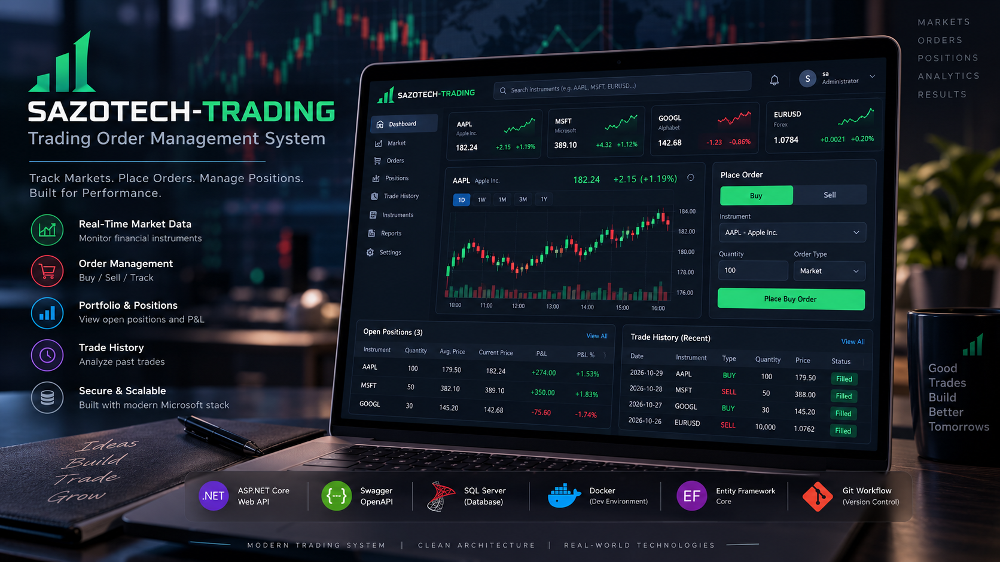
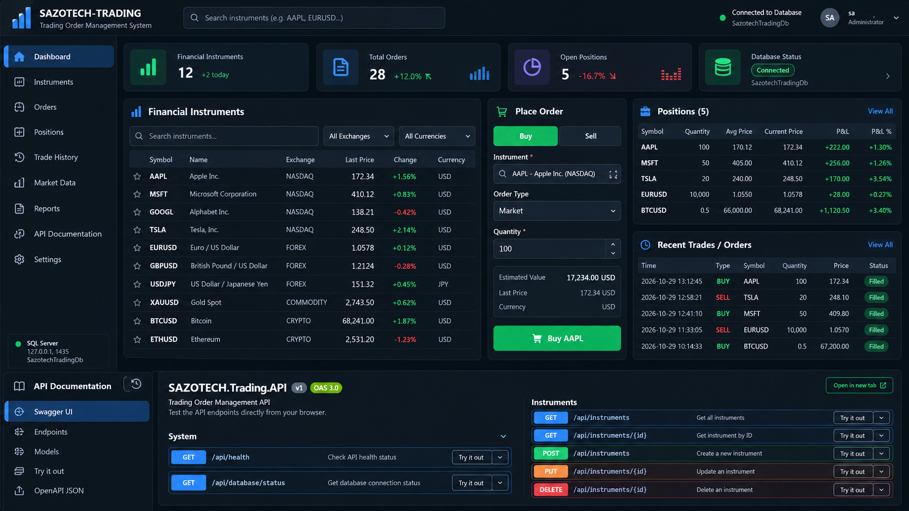

# SAZOTECH-TRADING

**Trading Order Management System | C# .NET 10 | ASP.NET Core Web API**





> **Project Status:** Phase 7 — Final Validation in Progress  
> **Release Target:** MVP V1.0  
> **Completed Phases:** 0–6  
> **Trading Environment:** Simulated trading only

## Project Overview

SAZOTECH-TRADING is a backend-focused trading order management system developed with C#, .NET 10, ASP.NET Core Web API, Entity Framework Core, and Microsoft SQL Server.

The application provides financial instrument management, BUY and SELL order registration, simulated order execution, portfolio position tracking, and basic portfolio valuation.

The project follows a Git feature-branch workflow with Conventional Commits and GitHub Pull Requests.

No real trading or financial transactions are performed.

## Technology Stack

| Category | Technology |
|---|---|
| Backend | C#, .NET 10, ASP.NET Core Web API |
| API Documentation | Swagger / OpenAPI |
| Database | Microsoft SQL Server 2022 |
| ORM | Entity Framework Core 10 |
| Database Migrations | EF Core Code First |
| Containers | Docker / Docker Compose |
| Database Management | SQL Server Management Studio |
| Automated Tests | xUnit |
| Test Database | SQLite in-memory |
| Security | .NET User Secrets, environment variables |
| Development | Visual Studio Code |
| Version Control | Git / GitHub |

## Development Progress

| Phase | Description | Status |
|---|---|---|
| 0 | Project Initialization & Git Setup | Completed |
| 1 | REST API & Swagger Setup | Completed |
| 2 | SQL Server, Docker & EF Core Integration | Completed |
| 3 | Financial Instruments CRUD API | Completed |
| 4 | Trading Orders Management | Completed |
| 5 | Order Execution & Portfolio Positions | Completed |
| 6 | Automated Testing with xUnit | Completed |
| 7 | Final Docker Setup & Documentation | In Progress |

## Implemented Features

### Phase 0 — Project Initialization

- Create the .NET solution and ASP.NET Core Web API project.
- Initialize Git and configure GitHub.
- Set up project documentation and `.gitignore`.
- Establish a feature-branch development workflow.

### Phase 1 — REST API & Swagger

- Configure ASP.NET Core API controllers.
- Enable Swagger / OpenAPI.
- Provide an application health-check endpoint.

### Phase 2 — Database Integration

- Run SQL Server 2022 using Docker Compose.
- Configure Entity Framework Core 10.
- Implement `TradingDbContext`.
- Create and apply database migrations.
- Configure local database credentials using .NET User Secrets.
- Provide a database connectivity endpoint.

### Phase 3 — Financial Instruments CRUD

- Create financial instruments.
- Retrieve all instruments or one instrument by ID.
- Update instrument information.
- Delete instruments when relational constraints permit.
- Validate instrument properties.
- Prevent duplicate instrument symbols.

### Phase 4 — Trading Orders Management

- Register BUY and SELL orders.
- Associate orders with existing instruments.
- Validate order types and quantities.
- Calculate order values using recorded prices.
- Store orders in SQL Server.
- Retrieve orders by ID or as a collection.
- Initialize orders with `NEW` status.

### Phase 5 — Order Execution & Portfolio Positions

- Execute pending BUY and SELL orders.
- Update successful orders to `EXECUTED`.
- Prevent sequential double execution.
- Reject SELL executions with insufficient holdings.
- Create and update aggregated portfolio positions.
- Calculate weighted average acquisition prices.
- Reduce holdings after SELL execution.
- Remove fully closed positions.
- Use database transactions to update orders and positions together.
- Provide portfolio retrieval endpoints.
- Calculate market value, cost basis, and unrealized P&L.

### Phase 6 — Automated Testing

- Create a dedicated xUnit test project.
- Configure SQLite in-memory databases for isolated tests.
- Test portfolio position model properties.
- Test BUY position creation and weighted average prices.
- Test partial and full SELL execution.
- Test insufficient holdings and missing positions.
- Test invalid orders and HTTP error responses.
- Verify sequential double-execution prevention.

**Latest validated result: 16 tests passed, 0 failed.**

### Phase 7 — Final Docker Setup & Documentation

Finalization activities include:

- Validate Docker Compose and SQL Server connectivity.
- Check database persistence and host-port mappings.
- Protect local secrets with `.gitignore`.
- Provide a safe `.env.example`.
- Ensure both API and xUnit projects are included in the solution.
- Document local port reservations.
- Perform final build, test, and startup verification.

## API Endpoints

### System

| Method | Endpoint | Description |
|---|---|---|
| GET | `/api/health` | Application health check |
| GET | `/api/database/status` | Database connectivity check |

### Financial Instruments

| Method | Endpoint | Description |
|---|---|---|
| GET | `/api/instruments` | Retrieve all instruments |
| GET | `/api/instruments/{id}` | Retrieve an instrument |
| POST | `/api/instruments` | Create an instrument |
| PUT | `/api/instruments/{id}` | Update an instrument |
| DELETE | `/api/instruments/{id}` | Delete an instrument |

### Trading Orders

| Method | Endpoint | Description |
|---|---|---|
| GET | `/api/orders` | Retrieve all orders |
| GET | `/api/orders/{id}` | Retrieve an order |
| POST | `/api/orders` | Create a BUY or SELL order |
| POST | `/api/orders/{id}/execute` | Execute a pending order |

### Portfolio Positions

| Method | Endpoint | Description |
|---|---|---|
| GET | `/api/positions` | Retrieve open positions |
| GET | `/api/positions/{id}` | Retrieve a position |

## Trading Workflow

1. Register or retrieve a financial instrument.
2. Create a BUY or SELL order.
3. Confirm that its status is `NEW`.
4. Execute the order.
5. Update the portfolio position and mark the order as `EXECUTED`.
6. Retrieve updated portfolio information.

### BUY Execution

A BUY increases the quantity held.

When a position already exists, the weighted average acquisition price is calculated using:

**New Average Price = (Existing Quantity × Existing Average Price + Purchased Quantity × Purchase Price) / Total Quantity**

### SELL Execution

A SELL decreases the quantity held.

The execution is refused if the requested quantity exceeds available holdings. Fully closed portfolio positions are removed while order history is retained.

### Order Statuses

| Status | Meaning |
|---|---|
| `NEW` | Registered but not yet executed |
| `EXECUTED` | Successfully executed |

A failed execution due to insufficient holdings returns HTTP `409`, while the order remains `NEW`.

## Portfolio Valuation

| Indicator | Formula |
|---|---|
| Market Value | Quantity × Current Price |
| Cost Basis | Quantity × Average Acquisition Price |
| Unrealized P&L | Market Value − Cost Basis |

These calculations use simulated prices and exclude fees, taxes, and realized P&L.

## Database Architecture

**Database:** `SazotechTradingDb`

| Table | Description |
|---|---|
| `FinancialInstruments` | Financial instrument reference data |
| `TradingOrders` | BUY and SELL order history |
| `PortfolioPositions` | Current aggregated holdings |
| `__EFMigrationsHistory` | EF Core migration history |

### Relationships

```text
FinancialInstruments
       |
       +------< TradingOrders
       |
       +------- PortfolioPositions
```

Each instrument may have multiple orders and at most one aggregated portfolio position.

## Project Structure

```text
SAZOTECH-TRADING/
├── SAZOTECH.Trading.API/
│   ├── Controllers/
│   ├── Data/
│   ├── Migrations/
│   ├── Models/
│   └── Program.cs
├── SAZOTECH.Trading.Tests/
│   ├── Controllers/
│   │   └── OrderExecutionsControllerTests.cs
│   ├── Models/
│   │   └── PortfolioPositionTests.cs
│   └── SAZOTECH.Trading.Tests.csproj
├── docs/
│   └── PORTS.md
├── image/
│   ├── INTERFACE_SAZOTECH_TRADING.png
│   └── INTERFACE_2.png
├── .env.example
├── README.md
├── docker-compose.yml
└── SAZOTECH-TRADING.slnx
```

## Local Development Ports

| Service | Host | Port |
|---|---|---|
| ASP.NET Core Web API | localhost | 5187 |
| Swagger UI | localhost | 5187 |
| SQL Server Docker | 127.0.0.1 | 1435 |
| SQL Server Container | Internal Docker network | 1433 |

**Important:** The Windows host port `1435` forwards traffic to SQL Server's internal container port `1433`.

### Complete Port Reference

See **[Local Port Reference](docs/PORTS.md)** for the full list of reserved development ports, Docker mappings, and Windows troubleshooting commands.

## Getting Started

### Prerequisites

- .NET 10 SDK
- Docker Desktop with Docker Compose
- Visual Studio Code or another compatible editor
- SQL Server Management Studio (optional)
- Git

### 1. Configure Docker Environment

Create a local `.env` file based on `.env.example`.

Replace the password placeholder with a strong SQL Server password.

Do not commit the real `.env` file.

### 2. Start SQL Server

```powershell
docker compose up -d
docker compose ps
```

### 3. Restore Dependencies

```powershell
dotnet restore
dotnet tool restore
```

### 4. Configure Database Access

Configure `ConnectionStrings:TradingDb` using .NET User Secrets for the API project.

The local database connection must point to SQL Server at `127.0.0.1,1435`.

Never store real database passwords in committed configuration files.

### 5. Apply Database Migrations

```powershell
dotnet tool run dotnet-ef database update --project SAZOTECH.Trading.API --startup-project SAZOTECH.Trading.API
```

### 6. Build the Solution

```powershell
dotnet build
```

### 7. Run Automated Tests

```powershell
dotnet test
```

Or run the test project directly:

```powershell
dotnet test SAZOTECH.Trading.Tests/SAZOTECH.Trading.Tests.csproj
```

### 8. Start the API

```powershell
dotnet run --project SAZOTECH.Trading.API --launch-profile http
```

### 9. Open Swagger

http://localhost:5187/swagger

### 10. Check Database Connectivity

Execute:

`GET /api/database/status`

A healthy connection should return HTTP `200`.

## Automated Testing Results

| Metric | Latest Validated Result |
|---|---:|
| Total | 16 |
| Passed | 16 |
| Failed | 0 |
| Skipped | 0 |

Tests use xUnit and SQLite in-memory databases to verify key trading rules without modifying the SQL Server development database.

### Testing Limitations

- SQL Server-specific integration testing remains future work.
- Concurrent execution scenarios require additional testing.
- SQLite behavior may differ from SQL Server transaction and locking behavior.

## API Usage Examples

### Create a BUY Order

**POST** `/api/orders`

```json
{
  "financialInstrumentId": 1,
  "orderType": "BUY",
  "quantity": 10
}
```

### Execute an Order

**POST** `/api/orders/1/execute`

The order and portfolio position are updated following successful execution.

### Retrieve the Portfolio

**GET** `/api/positions`

Example response:

```json
[
  {
    "id": 1,
    "financialInstrumentId": 1,
    "symbol": "AAPL",
    "name": "Apple Inc.",
    "quantity": 10,
    "averagePrice": 225.75,
    "currentPrice": 230.00,
    "marketValue": 2300.00,
    "costBasis": 2257.50,
    "unrealizedPnL": 42.50,
    "updatedAt": "2026-11-02T10:00:00Z"
  }
]
```

All identifiers and values in this example are illustrative.

## Git Workflow

Development uses feature branches, Conventional Commits, and GitHub Pull Requests.

```text
main
 ├── feature/project-setup
 ├── feature/database
 ├── feature/instruments
 ├── feature/trading-orders
 ├── feature/positions
 ├── feature/unit-tests
 └── feature/docker
```

## Known Limitations

- Single aggregated simulated portfolio
- No multi-account support
- No live market connections
- No real transactions
- No realized P&L calculation
- No custom web dashboard
- No comprehensive concurrent-execution tests
- No SQL Server-specific automated integration tests

## Future Improvements

- SQL Server integration testing
- Concurrency and transaction stress testing
- Additional order lifecycle states
- Authentication and authorization
- Multiple trading accounts and portfolios
- Realized profit and loss tracking
- Centralized logging and monitoring
- Fully containerized API deployment
- Custom trading dashboard

## Project Interface Preview

The images displayed at the top of this README are conceptual interface mockups.

The current MVP exposes a backend REST API documented through Swagger UI. A custom trading dashboard has not yet been implemented.

## Disclaimer

SAZOTECH-TRADING is an educational and portfolio project. All prices and trading operations are simulated. The application does not connect to live financial exchanges, provide investment advice, or perform real financial transactions.