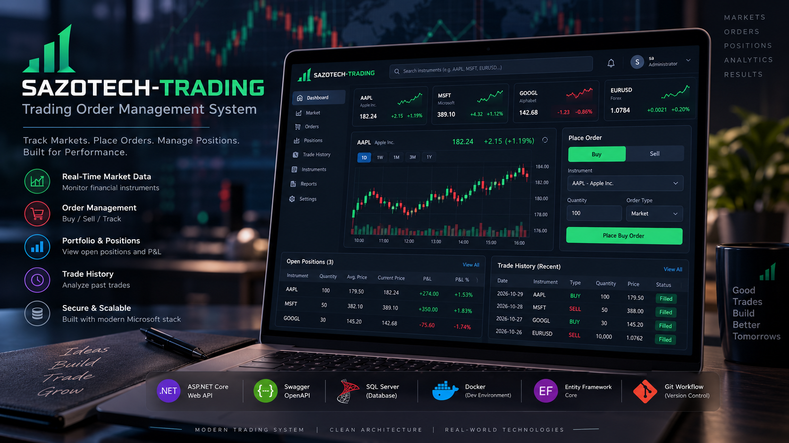
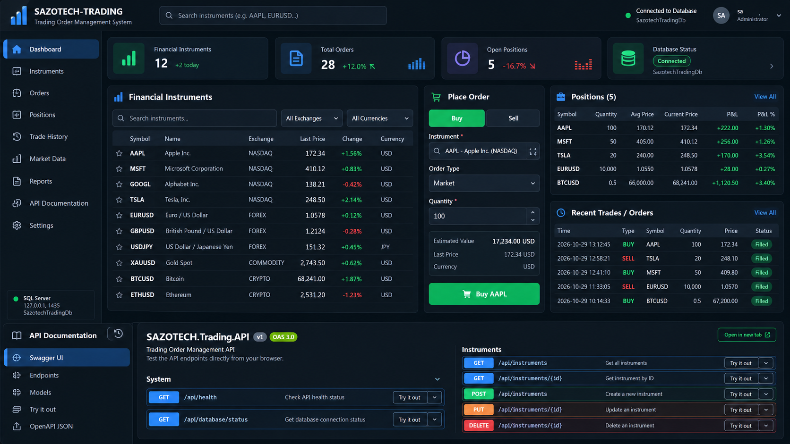

# SAZOTECH-TRADING

**Trading Order Management System | C# .NET 10 | ASP.NET Core Web API**





> **Project Status:** Phase 2 Completed — Database Integration  
> **Current Version:** MVP under development  
> **Next Phase:** Financial Instruments CRUD API

## Project Overview

SAZOTECH-TRADING is a backend-focused trading order management system designed to simulate financial instrument management, stock trading orders, trade execution, and portfolio positions.

The project follows an incremental development workflow using Git feature branches, conventional commits, and GitHub pull requests.

All trading operations use simulated data. No real financial transactions are performed.

## Technology Stack

- **Backend:** C#, .NET 10, ASP.NET Core Web API
- **API Documentation:** Swagger / OpenAPI
- **Database:** Microsoft SQL Server 2022
- **ORM:** Entity Framework Core 10
- **Containers:** Docker / Docker Compose
- **Database Management:** SQL Server Management Studio
- **Security:** .NET User Secrets, NuGet Vulnerability Auditing
- **Version Control:** Git / GitHub
- **Development Environment:** Visual Studio Code

## Development Progress

| Phase | Description | Status |
|---|---|---|
| 0 | Project Initialization & Git Setup | Completed |
| 1 | REST API & Swagger Setup | Completed |
| 2 | SQL Server, Docker & EF Core Integration | Completed |
| 3 | Financial Instruments CRUD API | Planned |
| 4 | Trading Orders Management | Planned |
| 5 | Trade Execution & Portfolio Positions | Planned |
| 6 | Unit Testing | Planned |
| 7 | Final Docker Setup & Documentation | Planned |

## Implemented Features

- ASP.NET Core REST API initialization
- Swagger / OpenAPI integration
- Application health endpoint
- SQL Server 2022 containerization
- Entity Framework Core configuration
- Financial Instrument data model
- Code First database migration
- Database connectivity health endpoint
- Secure local database configuration
- Git feature-branch workflow

## API Endpoints

| Method | Endpoint | Description |
|---|---|---|
| GET | `/api/health` | Application health check |
| GET | `/api/database/status` | SQL Server connectivity check |

Additional trading endpoints will be implemented in upcoming phases.

## Database

**Database:** `SazotechTradingDb`

**Database Tables:**
- `FinancialInstruments`
- `__EFMigrationsHistory`

**Local Development Connection:**
- SQL Server running in Docker
- Host: `127.0.0.1`
- Port: `1435`
- Internal container port: `1433`

Database credentials are excluded from version control.

## Running the Project

Start the SQL Server container:

```bash
docker compose up -d
```

Restore dependencies and build:

```bash
dotnet restore
dotnet build
```

Start the API:

```bash
dotnet run --project SAZOTECH.Trading.API --launch-profile http
```

Open Swagger UI:

http://localhost:5187/swagger

**Note:** Configure the `TradingDb` connection string using .NET User Secrets before running database-dependent endpoints.

## Git Workflow

Each development phase is implemented using a dedicated feature branch.

```text
main
 ├── feature/project-setup
 ├── feature/database
 ├── feature/instruments
 ├── feature/trading-orders
 ├── feature/positions
 ├── feature/unit-tests
 └── feature/docker
```

Changes are committed using Conventional Commits and integrated through GitHub Pull Requests.

## Future Improvements

- Financial instrument CRUD operations
- Buy and sell order processing
- Order validation and execution simulation
- Portfolio position tracking
- Trade history
- Unit and integration testing

## Disclaimer

This project is developed for educational and portfolio purposes. It uses simulated financial data and does not execute real market transactions.